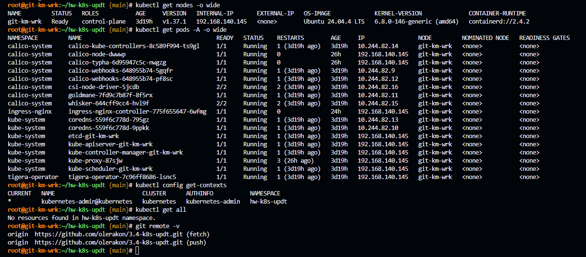
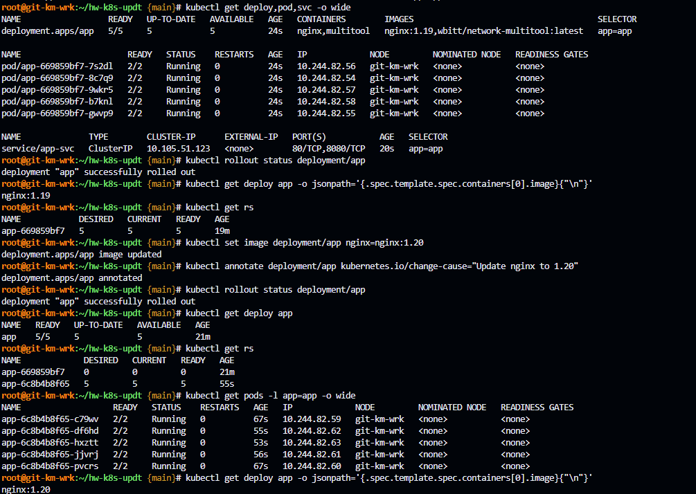
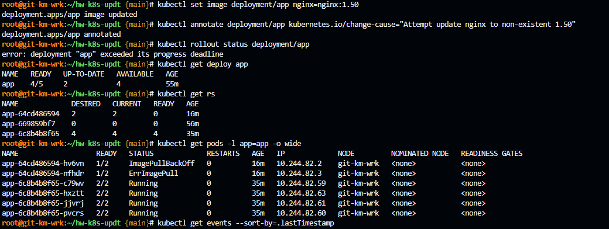
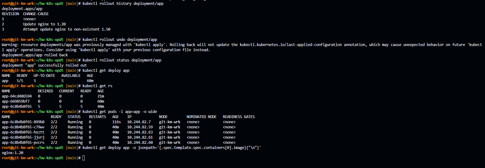
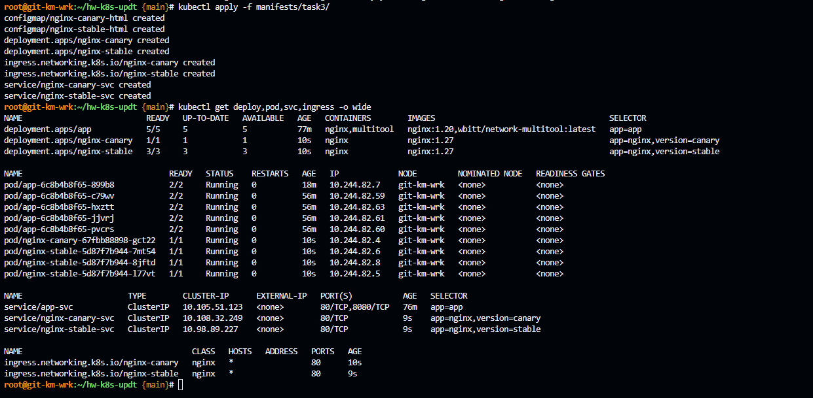

# Домашнее задание к занятию «Обновление приложений» - `Гилельс Кирилл`

### Цель задания

Уважаемые студенты! В этом задании вам предстоит выбрать и настроить стратегию обновления приложения.

### Чеклист готовности к домашнему заданию

1. Кластер K8s.
2. Для задания 3* — Ingress-контроллер в кластере (например, Ingress NGINX).

### Инструменты и дополнительные материалы, которые пригодятся для выполнения задания

1. [Документация Updating a Deployment](https://kubernetes.io/docs/concepts/workloads/controllers/deployment/#updating-a-deployment).
2. [Статья про стратегии обновлений](https://habr.com/ru/companies/flant/articles/471620/).

-----

# Описание задания

Задание состоит из трёх частей (две обязательные и одна дополнительная).

### Задание 1. Выбрать стратегию обновления приложения и описать ваш выбор

1. Имеется приложение, состоящее из нескольких реплик, которое требуется обновить.
2. Ресурсы, выделенные для приложения, ограничены, и нет возможности их увеличить.
3. Запас по ресурсам в менее загруженный момент времени составляет 20%.
4. Обновление мажорное, новые версии приложения не умеют работать со старыми.
5. Вам нужно объяснить свой выбор стратегии обновления приложения.

### Задание 2. Обновить приложение

1. Создать deployment приложения с контейнерами nginx и multitool. Версию nginx взять 1.19. Количество реплик — 5.Для multitool задайте HTTP_PORT и HTTPS_PORT, отличные от портов nginx, чтобы избежать конфликта.
2. Обновить версию nginx в приложении до версии 1.20, сократив время обновления до минимума. Приложение должно быть доступно.
3. Попытаться обновить nginx до заведомо несуществующей версии (например, 1.50); приложение должно оставаться доступным.
4. Откатиться после неудачного обновления.

------

## Дополнительные задания — со звёздочкой*

Задания дополнительные, необязательные к выполнению, они не повлияют на получение зачёта по домашнему заданию. **Но мы настоятельно рекомендуем вам выполнять все задания со звёздочкой.** Это поможет лучше разобраться в материале.   

### Задание 3*. Создать Canary deployment

1. Создать два deployment'а приложения nginx.
2. При помощи разных ConfigMap сделать две версии приложения — веб-страницы.
3. С помощью ingress создать канареечный деплоймент, чтобы можно было часть трафика перебросить на разные версии приложения.

### Правила приёма работы

1. Домашняя работа оформляется в своем Git-репозитории в файле README.md. Выполненное домашнее задание пришлите ссылкой на .md-файл в вашем репозитории.
2. Файл README.md должен содержать скриншоты вывода необходимых команд, а также скриншоты результатов.
3. Репозиторий должен содержать тексты манифестов или ссылки на них в файле README.md.

------

# Решение

## Предварительная информация

На VM Ubuntu 24.04 LTS был развернут полноценный kubernetes версии 1.37.1 в формате all-in-one-single-node средствами kubeadm.

IP адресс машины 192.168.140.145

В качестве сетевого плагина был выбран calico. Network cidr: 10.244.0.0/16

Так же был инициализирован гит [репозиторий](https://github.com/olerakon/3.4-k8s-updt) проекта 

Для домашнего задания был создан отдельный ns: `hw-k8s-updt` и настроена дефолтная работа в нем через kubectl.

Сводная информация представлена на скриншоте:



Примечание: Условие домашнего задания частично перенесено из ЛК в формат .md, если нужно можете использовать.

------

## Задание 1. Выбор стратегии обновления приложения

Условия:

- Приложение состоит из нескольких реплик.
- Ресурсы кластера ограничены, увеличить их нельзя.
- В менее загруженное время есть запас 20%.
- Обновление мажорное.
- Новая версия несовместима со старой.

## Выбранная стратегия — RollingUpdate

Deployment постепенно создаёт новые Pod и удаляет старые. При этом поддерживается заданное количество доступных реплик, поэтому приложение остаётся доступным во время обновления.
Обновление проводится в наименее нагруженное время, так что сохраняется запас в 20 процентов на замену подов.


## Почему не Recreate

Стратегия `Recreate` сначала удаляет все старые Pod и только затем создаёт новые. Это приводит к простою, данная схема приводит в нашем случае к логическому противоречию - она могла бы подорйти при обновлении в пиковое время, когда нет запаса ресурсов, однако никто не обновляет мажорные версии в пиковое время. А в непиковое время есть запас в 20% что позволяет сделать ограниченный RollingUpdate. Данную схему можно использовать если мажорное обновление несет критическую важность и необходимо его выпустить его "еще вчера", в таких случаях допустим и даунтайм приложения.

### Почему не Blue-Green

Blue-Green требует одновременно держать две полные копии приложения: старую и новую. При 5 репликах это означает до 10 реплик во время переключения. С учётом ограничения ресурсов и запаса всего 20% такой подход не подходит.

### Почему не Canary

Canary подходит для постепенной проверки новой версии на части трафика. Но при несовместимости мажорных версий одновременная работа старой и новой версии может приводить к ошибкам. Кроме того, canary обычно требует отдельного Ingress и маршрутизации трафика.

### Настройка RollingUpdate

```yaml
strategy:
  type: RollingUpdate
  rollingUpdate:
    maxSurge: 1
    maxUnavailable: 1
```

- `maxSurge: 1` — во время обновления создаётся не более одного дополнительного Pod.
- `maxUnavailable: 1` — одновременно может быть недоступен не более одного старого Pod.
- Из 5 реплик минимум 4 остаются доступными.
- Обновление идёт быстро, но не требует ресурсов для полного дублирования приложения.

### Обработка неудачного обновления

Если новая версия не запускается, например из-за несуществующего образа, Deployment остановит масштабирование нового ReplicaSet. Старые Pod продолжат работать, и приложение останется доступным.

Для отката используется:

```bash
kubectl rollout undo deployment/app
```

## Задание 2. Обновить приложение

1. Создал [deployment](./manifests/task2/deployment.yaml) и [service](./manifests/task2/service.yaml) приложения с контейнерами nginx и multitool. Версию nginx взял 1.19. Количество реплик — 5. Для multitool задал HTTP_PORT и HTTPS_PORT, отличные от портов nginx, чтобы избежать конфликта.
2. Обновил версию nginx в приложении до версии 1.20, сократив время обновления до минимума. Приложение должно быть доступно.

Примечание: обратил внимание на строку `сократив время обновления до минимума. Приложение должно быть доступно.` уже на этапе оформления отчета. Манифест не переделывал.

Для максимального сокращения времени обновления до минимума необходимо изменить параметры 
- `maxSurge: 5` — во время обновления создаётся не более 5 дополнительных Pod.
- `maxUnavailable: 4` — одновременно может быть недоступен не более 4 старорых Pod.
Так как останется один Pod версии 1.19, доступность приложения не потеряется.

Примечание: скриншот выполнен с манифестом под старые параметры.
```yaml
    maxSurge: 1
    maxUnavailable: 1
```



3. Попытался обновить nginx до заведомо несуществующей версии 1.50; приложение осталось доступным.



```bash
kubectl get events --sort-by=.lastTimestamp
LAST SEEN   TYPE      REASON              OBJECT                      MESSAGE
56m         Normal    SuccessfulCreate    replicaset/app-669859bf7    Created pod: app-669859bf7-8c7q9
56m         Normal    Scheduled           pod/app-669859bf7-9wkr5     Successfully assigned hw-k8s-updt/app-669859bf7-9wkr5 to git-km-wrk
56m         Normal    SuccessfulCreate    replicaset/app-669859bf7    Created pod: app-669859bf7-7s2dl
56m         Normal    SuccessfulCreate    replicaset/app-669859bf7    Created pod: app-669859bf7-b7knl
56m         Normal    SuccessfulCreate    replicaset/app-669859bf7    Created pod: app-669859bf7-9wkr5
56m         Normal    SuccessfulCreate    replicaset/app-669859bf7    Created pod: app-669859bf7-gwvp9
56m         Normal    Scheduled           pod/app-669859bf7-gwvp9     Successfully assigned hw-k8s-updt/app-669859bf7-gwvp9 to git-km-wrk
56m         Normal    Scheduled           pod/app-669859bf7-b7knl     Successfully assigned hw-k8s-updt/app-669859bf7-b7knl to git-km-wrk
56m         Normal    ScalingReplicaSet   deployment/app              Scaled up replica set app-669859bf7 from 0 to 5
56m         Normal    Scheduled           pod/app-669859bf7-7s2dl     Successfully assigned hw-k8s-updt/app-669859bf7-7s2dl to git-km-wrk
56m         Normal    Scheduled           pod/app-669859bf7-8c7q9     Successfully assigned hw-k8s-updt/app-669859bf7-8c7q9 to git-km-wrk
56m         Normal    Pulling             pod/app-669859bf7-gwvp9     Pulling image "nginx:1.19"
56m         Normal    Pulling             pod/app-669859bf7-8c7q9     Pulling image "nginx:1.19"
56m         Normal    Pulling             pod/app-669859bf7-7s2dl     Pulling image "nginx:1.19"
56m         Normal    Pulling             pod/app-669859bf7-9wkr5     Pulling image "nginx:1.19"
56m         Normal    Pulling             pod/app-669859bf7-b7knl     Pulling image "nginx:1.19"
56m         Normal    Started             pod/app-669859bf7-8c7q9     Container started
56m         Normal    Created             pod/app-669859bf7-8c7q9     Container created
56m         Normal    Pulled              pod/app-669859bf7-8c7q9     Successfully pulled image "nginx:1.19" in 10.549s (10.549s including waiting). Image size: 53736948 bytes.
56m         Normal    Pulling             pod/app-669859bf7-8c7q9     Pulling image "wbitt/network-multitool:latest"
56m         Normal    Pulled              pod/app-669859bf7-7s2dl     Successfully pulled image "nginx:1.19" in 1.138s (11.276s including waiting). Image size: 53736948 bytes.
56m         Normal    Created             pod/app-669859bf7-7s2dl     Container created
56m         Normal    Started             pod/app-669859bf7-7s2dl     Container started
56m         Normal    Pulling             pod/app-669859bf7-7s2dl     Pulling image "wbitt/network-multitool:latest"
56m         Normal    Created             pod/app-669859bf7-gwvp9     Container created
56m         Normal    Started             pod/app-669859bf7-gwvp9     Container started
56m         Normal    Pulling             pod/app-669859bf7-gwvp9     Pulling image "wbitt/network-multitool:latest"
56m         Normal    Pulled              pod/app-669859bf7-gwvp9     Successfully pulled image "nginx:1.19" in 1.119s (12.386s including waiting). Image size: 53736948 bytes.
56m         Normal    Pulling             pod/app-669859bf7-9wkr5     Pulling image "wbitt/network-multitool:latest"
56m         Normal    Pulled              pod/app-669859bf7-9wkr5     Successfully pulled image "nginx:1.19" in 1.101s (13.379s including waiting). Image size: 53736948 bytes.
56m         Normal    Started             pod/app-669859bf7-9wkr5     Container started
56m         Normal    Created             pod/app-669859bf7-9wkr5     Container created
56m         Normal    Pulled              pod/app-669859bf7-b7knl     Successfully pulled image "nginx:1.19" in 1.155s (14.504s including waiting). Image size: 53736948 bytes.
56m         Normal    Created             pod/app-669859bf7-b7knl     Container created
56m         Normal    Started             pod/app-669859bf7-b7knl     Container started
56m         Normal    Pulling             pod/app-669859bf7-b7knl     Pulling image "wbitt/network-multitool:latest"
56m         Normal    Pulled              pod/app-669859bf7-8c7q9     Successfully pulled image "wbitt/network-multitool:latest" in 1.139s (5.543s including waiting). Image size: 26477354 bytes.
56m         Normal    Created             pod/app-669859bf7-8c7q9     Container created
56m         Normal    Started             pod/app-669859bf7-8c7q9     Container started
56m         Normal    Pulled              pod/app-669859bf7-7s2dl     Successfully pulled image "wbitt/network-multitool:latest" in 1.152s (5.528s including waiting). Image size: 26477354 bytes.
56m         Normal    Started             pod/app-669859bf7-7s2dl     Container started
56m         Normal    Created             pod/app-669859bf7-7s2dl     Container created
56m         Normal    Pulled              pod/app-669859bf7-gwvp9     Successfully pulled image "wbitt/network-multitool:latest" in 1.127s (5.585s including waiting). Image size: 26477354 bytes.
56m         Normal    Started             pod/app-669859bf7-gwvp9     Container started
56m         Normal    Created             pod/app-669859bf7-gwvp9     Container created
56m         Normal    Created             pod/app-669859bf7-9wkr5     Container created
56m         Normal    Started             pod/app-669859bf7-9wkr5     Container started
56m         Normal    Pulled              pod/app-669859bf7-9wkr5     Successfully pulled image "wbitt/network-multitool:latest" in 1.086s (5.581s including waiting). Image size: 26477354 bytes.
56m         Normal    Started             pod/app-669859bf7-b7knl     Container started
56m         Normal    Created             pod/app-669859bf7-b7knl     Container created
56m         Normal    Pulled              pod/app-669859bf7-b7knl     Successfully pulled image "wbitt/network-multitool:latest" in 1.11s (5.53s including waiting). Image size: 26477354 bytes.
36m         Normal    ScalingReplicaSet   deployment/app              Scaled up replica set app-6c8b4b8f65 from 1 to 2
36m         Normal    SuccessfulCreate    replicaset/app-6c8b4b8f65   Created pod: app-6c8b4b8f65-c79wv
36m         Normal    SuccessfulDelete    replicaset/app-669859bf7    Deleted pod: app-669859bf7-7s2dl
36m         Normal    ScalingReplicaSet   deployment/app              Scaled down replica set app-669859bf7 from 5 to 4
36m         Normal    ScalingReplicaSet   deployment/app              Scaled up replica set app-6c8b4b8f65 from 0 to 1
36m         Normal    Scheduled           pod/app-6c8b4b8f65-c79wv    Successfully assigned hw-k8s-updt/app-6c8b4b8f65-c79wv to git-km-wrk
36m         Normal    SuccessfulCreate    replicaset/app-6c8b4b8f65   Created pod: app-6c8b4b8f65-pvcrs
36m         Normal    Scheduled           pod/app-6c8b4b8f65-pvcrs    Successfully assigned hw-k8s-updt/app-6c8b4b8f65-pvcrs to git-km-wrk
36m         Normal    Killing             pod/app-669859bf7-7s2dl     Stopping container multitool
36m         Normal    Killing             pod/app-669859bf7-7s2dl     Stopping container nginx
36m         Normal    Pulling             pod/app-6c8b4b8f65-c79wv    Pulling image "nginx:1.20"
36m         Normal    Pulling             pod/app-6c8b4b8f65-pvcrs    Pulling image "nginx:1.20"
36m         Normal    Created             pod/app-6c8b4b8f65-c79wv    Container created
36m         Normal    Pulled              pod/app-6c8b4b8f65-c79wv    Successfully pulled image "nginx:1.20" in 7.151s (7.152s including waiting). Image size: 56732885 bytes.
36m         Normal    Started             pod/app-6c8b4b8f65-c79wv    Container started
36m         Normal    Pulling             pod/app-6c8b4b8f65-c79wv    Pulling image "wbitt/network-multitool:latest"
36m         Normal    Pulling             pod/app-6c8b4b8f65-pvcrs    Pulling image "wbitt/network-multitool:latest"
36m         Normal    Started             pod/app-6c8b4b8f65-pvcrs    Container started
36m         Normal    Created             pod/app-6c8b4b8f65-pvcrs    Container created
36m         Normal    Pulled              pod/app-6c8b4b8f65-pvcrs    Successfully pulled image "nginx:1.20" in 1.104s (8.189s including waiting). Image size: 56732885 bytes.
36m         Normal    Created             pod/app-6c8b4b8f65-c79wv    Container created
36m         Normal    Pulled              pod/app-6c8b4b8f65-c79wv    Successfully pulled image "wbitt/network-multitool:latest" in 1.18s (2.18s including waiting). Image size: 26477354 bytes.
36m         Normal    Killing             pod/app-669859bf7-8c7q9     Stopping container nginx
36m         Normal    Started             pod/app-6c8b4b8f65-c79wv    Container started
36m         Normal    Killing             pod/app-669859bf7-8c7q9     Stopping container multitool
36m         Normal    ScalingReplicaSet   deployment/app              Scaled up replica set app-6c8b4b8f65 from 2 to 3
36m         Normal    Scheduled           pod/app-6c8b4b8f65-jjvrj    Successfully assigned hw-k8s-updt/app-6c8b4b8f65-jjvrj to git-km-wrk
36m         Normal    ScalingReplicaSet   deployment/app              Scaled down replica set app-669859bf7 from 4 to 3
36m         Normal    SuccessfulCreate    replicaset/app-6c8b4b8f65   Created pod: app-6c8b4b8f65-jjvrj
36m         Normal    SuccessfulDelete    replicaset/app-669859bf7    Deleted pod: app-669859bf7-8c7q9
36m         Normal    Scheduled           pod/app-6c8b4b8f65-df6hd    Successfully assigned hw-k8s-updt/app-6c8b4b8f65-df6hd to git-km-wrk
36m         Normal    Pulled              pod/app-6c8b4b8f65-jjvrj    Container image "nginx:1.20" already present on machine and can be accessed by the pod
36m         Normal    ScalingReplicaSet   deployment/app              Scaled up replica set app-6c8b4b8f65 from 3 to 4
36m         Normal    SuccessfulDelete    replicaset/app-669859bf7    Deleted pod: app-669859bf7-gwvp9
36m         Normal    ScalingReplicaSet   deployment/app              Scaled down replica set app-669859bf7 from 3 to 2
36m         Normal    SuccessfulCreate    replicaset/app-6c8b4b8f65   Created pod: app-6c8b4b8f65-df6hd
36m         Normal    Started             pod/app-6c8b4b8f65-pvcrs    Container started
36m         Normal    Created             pod/app-6c8b4b8f65-pvcrs    Container created
36m         Normal    Pulled              pod/app-6c8b4b8f65-pvcrs    Successfully pulled image "wbitt/network-multitool:latest" in 1.24s (2.319s including waiting). Image size: 26477354 bytes.
36m         Normal    Killing             pod/app-669859bf7-gwvp9     Stopping container multitool
36m         Normal    Killing             pod/app-669859bf7-gwvp9     Stopping container nginx
36m         Normal    Pulling             pod/app-6c8b4b8f65-jjvrj    Pulling image "wbitt/network-multitool:latest"
36m         Normal    Started             pod/app-6c8b4b8f65-jjvrj    Container started
36m         Normal    Created             pod/app-6c8b4b8f65-jjvrj    Container created
36m         Normal    Started             pod/app-6c8b4b8f65-df6hd    Container started
36m         Normal    Pulling             pod/app-6c8b4b8f65-df6hd    Pulling image "wbitt/network-multitool:latest"
36m         Normal    Pulled              pod/app-6c8b4b8f65-df6hd    Container image "nginx:1.20" already present on machine and can be accessed by the pod
36m         Normal    Created             pod/app-6c8b4b8f65-df6hd    Container created
36m         Normal    Pulled              pod/app-6c8b4b8f65-jjvrj    Successfully pulled image "wbitt/network-multitool:latest" in 1.106s (1.106s including waiting). Image size: 26477354 bytes.
36m         Normal    SuccessfulDelete    replicaset/app-669859bf7    Deleted pod: app-669859bf7-9wkr5
36m         Normal    ScalingReplicaSet   deployment/app              Scaled down replica set app-669859bf7 from 2 to 1
36m         Normal    ScalingReplicaSet   deployment/app              Scaled up replica set app-6c8b4b8f65 from 4 to 5
36m         Normal    Killing             pod/app-669859bf7-9wkr5     Stopping container nginx
36m         Normal    Killing             pod/app-669859bf7-9wkr5     Stopping container multitool
36m         Normal    SuccessfulCreate    replicaset/app-6c8b4b8f65   Created pod: app-6c8b4b8f65-hxztt
36m         Normal    Scheduled           pod/app-6c8b4b8f65-hxztt    Successfully assigned hw-k8s-updt/app-6c8b4b8f65-hxztt to git-km-wrk
36m         Normal    Started             pod/app-6c8b4b8f65-jjvrj    Container started
36m         Normal    Created             pod/app-6c8b4b8f65-jjvrj    Container created
36m         Normal    SuccessfulDelete    replicaset/app-669859bf7    Deleted pod: app-669859bf7-b7knl
36m         Normal    Started             pod/app-6c8b4b8f65-df6hd    Container started
36m         Normal    ScalingReplicaSet   deployment/app              (combined from similar events): Scaled down replica set app-669859bf7 from 1 to 0
36m         Normal    Pulled              pod/app-6c8b4b8f65-df6hd    Successfully pulled image "wbitt/network-multitool:latest" in 1.132s (1.197s including waiting). Image size: 26477354 bytes.
36m         Normal    Created             pod/app-6c8b4b8f65-df6hd    Container created
36m         Normal    Pulling             pod/app-6c8b4b8f65-hxztt    Pulling image "wbitt/network-multitool:latest"
36m         Normal    Killing             pod/app-669859bf7-b7knl     Stopping container nginx
36m         Normal    Killing             pod/app-669859bf7-b7knl     Stopping container multitool
36m         Normal    Pulled              pod/app-6c8b4b8f65-hxztt    Container image "nginx:1.20" already present on machine and can be accessed by the pod
36m         Normal    Created             pod/app-6c8b4b8f65-hxztt    Container created
36m         Normal    Started             pod/app-6c8b4b8f65-hxztt    Container started
36m         Normal    Pulled              pod/app-6c8b4b8f65-hxztt    Successfully pulled image "wbitt/network-multitool:latest" in 1.145s (1.145s including waiting). Image size: 26477354 bytes.
36m         Normal    Started             pod/app-6c8b4b8f65-hxztt    Container started
36m         Normal    Created             pod/app-6c8b4b8f65-hxztt    Container created
17m         Normal    ScalingReplicaSet   deployment/app              Scaled down replica set app-6c8b4b8f65 from 5 to 4
17m         Normal    ScalingReplicaSet   deployment/app              Scaled up replica set app-64cd486594 from 0 to 1
17m         Normal    Killing             pod/app-6c8b4b8f65-df6hd    Stopping container multitool
17m         Normal    Scheduled           pod/app-64cd486594-hv6vn    Successfully assigned hw-k8s-updt/app-64cd486594-hv6vn to git-km-wrk
17m         Normal    ScalingReplicaSet   deployment/app              Scaled up replica set app-64cd486594 from 1 to 2
17m         Normal    SuccessfulCreate    replicaset/app-64cd486594   Created pod: app-64cd486594-hv6vn
17m         Normal    SuccessfulCreate    replicaset/app-64cd486594   Created pod: app-64cd486594-nfhdr
17m         Normal    Killing             pod/app-6c8b4b8f65-df6hd    Stopping container nginx
17m         Normal    Scheduled           pod/app-64cd486594-nfhdr    Successfully assigned hw-k8s-updt/app-64cd486594-nfhdr to git-km-wrk
17m         Normal    SuccessfulDelete    replicaset/app-6c8b4b8f65   Deleted pod: app-6c8b4b8f65-df6hd
17m         Normal    Pulling             pod/app-64cd486594-nfhdr    Pulling image "wbitt/network-multitool:latest"
17m         Normal    Pulling             pod/app-64cd486594-hv6vn    Pulling image "wbitt/network-multitool:latest"
17m         Normal    Started             pod/app-64cd486594-nfhdr    Container started
17m         Normal    Pulled              pod/app-64cd486594-nfhdr    Successfully pulled image "wbitt/network-multitool:latest" in 1.124s (2.17s including waiting). Image size: 26477354 bytes.
17m         Normal    Created             pod/app-64cd486594-nfhdr    Container created
16m         Normal    Created             pod/app-64cd486594-hv6vn    Container created
16m         Normal    Pulled              pod/app-64cd486594-hv6vn    Successfully pulled image "wbitt/network-multitool:latest" in 1.186s (2.31s including waiting). Image size: 26477354 bytes.
16m         Normal    Started             pod/app-64cd486594-hv6vn    Container started
13m         Normal    Pulling             pod/app-64cd486594-nfhdr    Pulling image "nginx:1.50"
13m         Warning   Failed              pod/app-64cd486594-nfhdr    Error: ErrImagePull
13m         Warning   Failed              pod/app-64cd486594-nfhdr    Failed to pull image "nginx:1.50": rpc error: code = NotFound desc = failed to pull and unpack image "docker.io/library/nginx:1.50": failed to resolve image: docker.io/library/nginx:1.50: not found
13m         Normal    Pulling             pod/app-64cd486594-hv6vn    Pulling image "nginx:1.50"
13m         Warning   Failed              pod/app-64cd486594-hv6vn    Error: ErrImagePull
13m         Warning   Failed              pod/app-64cd486594-hv6vn    Failed to pull image "nginx:1.50": rpc error: code = NotFound desc = failed to pull and unpack image "docker.io/library/nginx:1.50": failed to resolve image: docker.io/library/nginx:1.50: not found
116s        Normal    BackOff             pod/app-64cd486594-hv6vn    Back-off pulling image "nginx:1.50"
116s        Warning   Failed              pod/app-64cd486594-hv6vn    Error: ImagePullBackOff
110s        Warning   Failed              pod/app-64cd486594-nfhdr    Error: ImagePullBackOff
110s        Normal    BackOff             pod/app-64cd486594-nfhdr    Back-off pulling image "nginx:1.50"
```
4. Откатился после неудачного обновления.



### Задание 3*. Создать Canary deployment

1. Создал два [deployment-stable](./manifests/task3/deployment-stable.yaml) и [deployment-canary](./manifests/task3/deployment-canary.yaml) приложения nginx.
Соответствующие [service-stable](./manifests/task3/service-stable.yaml) [service-canary](./manifests/task3/service-canary.yaml).
2. При помощи разных ConfigMap [stable](./manifests/task3/configmap-stable.yaml) и [canary](./manifests/task3/configmap-canary.yaml) сделал две версии приложения — веб-страницы.
3. С помощью [ingress](./manifests/task3/ingress-canary.yaml) создал канареечный деплоймент, чтобы можно было часть трафика перебросить на разные версии приложения.


